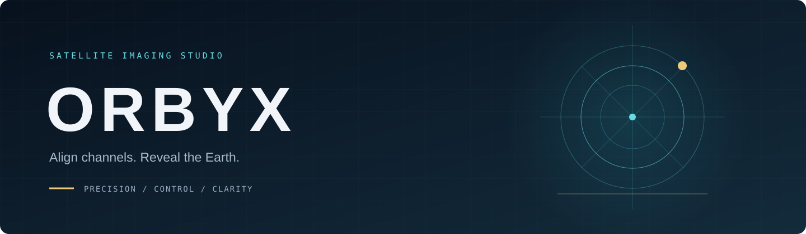

<p align="center"></p>

<p align="center"><a href="README.it.md">🇮🇹 Italiano</a> · <a href="README.en.md">🇬🇧 English</a></p>

<p align="center">
<a href="https://github.com/chiaraberti13/ORBYX/actions/workflows/ci.yml"></a>


</p>

> Allinea i canali. Rivela la Terra. Un ambiente desktop e headless indipendente per allineare i canali satellitari RDAS.

<p align="center"><a href="ROADMAP.md">Roadmap</a> · <a href="PROGRESS.md">Verifiche</a> · <a href="docs/AUDIT.md">Audit</a> · <a href="SECURITY.md">Sicurezza</a> · <a href="THIRD_PARTY_NOTICES.md">Attribuzioni</a></p>

## Start here — Ubuntu

ORBYX is a desktop application for aligning satellite images and exporting Natural Color. No CMake knowledge or personal paths are required. Run one command block at a time and stop if a step fails.

### 1. Open a terminal

Press Ctrl+Alt+T. For an existing checkout, open its folder in the file manager and choose Open in Terminal.

### 2. Download or update

First time:

```bash
git clone https://github.com/chiaraberti13/ORBYX.git
cd ORBYX
```

If Git is missing, install it and retry:

```bash
sudo apt-get -o DPkg::Lock::Timeout=900 install -y git
```

Already downloaded? Run this from the project folder instead of cloning again:

```bash
git pull
```

### 3. Install

```bash
bash install.sh --lang en
```

Enter your Ubuntu password when asked; invisible password characters are normal. Do not run the whole script with sudo. Setup waits for automatic package updates; never remove locks or kill package managers. Configuration, compilation, tests and user installation are automatic and may take several minutes.

Proceed only after **Installation completed** appears. Otherwise check **logs**.

### 4. Open the desktop

```bash
bash start.sh
```

Reuse this command on later launches. For updates, close the application, run `git pull`, then rerun the installer.

### Which button do I press? Quick guide

This is the most important part: **each button does a different thing**. Look at what you have and use **one** button.

| Your situation | Press this | What you choose |
|---|---|---|
| **I just want to see how it works** (no data of my own) | **Automatic generation** (Ctrl+Shift+D) | Nothing. It starts on its own with the bundled example images. |
| **I have 6 JPEG photos** named `sx_`/`dx_` MSUGS-VIS-1/2/3 | **Image simulation…** (Ctrl+Shift+S) | The folder containing the 6 photos. |
| **I have real data decoded by SatDump** | **Create final image…** | A folder that **directly** contains the `MSUGS_VIS1`, `MSUGS_VIS2`, … subfolders. |
| **I want to compose or retouch portions by hand** | **Compose portions and colour…** → *Add editable demo portions* | Already-aligned images, or the bundled demo portions. |

> ⚠️ **The most common mistake.** The **Create final image…** button only works with real SatDump data. If you point it at the **demo photos** (the six JPEGs) you get a red message like "this is not a SatDump VIS export": **that is expected**, that window is not meant for the demo photos. For the demo photos use **Automatic generation** or **Image simulation…**.
>
> The difference: real SatDump data are **folders** (`MSUGS_VIS1`, `MSUGS_VIS2`, …) each holding three channels `MSUGS-VIS-1/2/3.png`; the demo photos are instead **six** `.jpg` files in one folder.

**Not sure where to start?** Press **Automatic generation**: it is the fastest way to see an image right away, with nothing to set. When it finishes, the result appears by itself in the preview.

### No data yet? Try the demo

```bash
bash demo.sh --lang en
```

Press **Automatic generation** in the app (Ctrl+Shift+D). Six bundled real JPEG previews, three SX and three DX, are composed into one image with no parameters to set. No manual paths are needed. The command opens the same built-in demo; `bash demo.sh --no-open` runs it offscreen into demo-output, with logs. To pick the folder yourself use **Image simulation…** (Ctrl+Shift+S). These are 8-bit previews, not absolute geometry or radiometrically calibrated true colour. [Source details](assets/demo-jpeg/SOURCE.md).

### New desktop workflows

- **Compose portions and colour…**: multiple editable layers, automatic overlap and uniform-border crop proposals, seam inspection with replace/feather/minimum-cost-seam/multiband blending, include/exclude polygon masks, visual brightness/colour matching between layers, single-channel presets, histogram and clipping readout, and a quality assessment that never declares an image "perfect". Save a portable project (relative paths) with autosave and recovery, export it as a self-contained package, and export one native-depth PNG with a reproducible report. No fixed left/right layout. [Guide](docs/COMPOSITOR.md).
- **Create final image…**: five-step guided path **for real SatDump data** (not for the demo photos). At step 1 you must point to a folder that **directly** contains the `MSUGS_VIS1`, `MSUGS_VIS2`, … subfolders; choosing the wrong folder (such as the demo photos or your Documents folder) is reported and the wizard stops. Then review alignment/join/colour, start processing, and the editor opens automatically on the result. *To try it without SatDump data, use Automatic generation or Image simulation… instead (see "Which button do I press?").*

- **Guided calibration…** validates input/destination and prepares ECC scale/satellite settings. Successful calibration selects the new profile for alignment.
- **Monitor acquisitions…** discovers stable native SatDump products. Manual import and opt-in matching-satellite queueing never start processing automatically.
- Queue edits survive restarts. Completed jobs need digest verification before their completion is trusted again; double-click to review parameters.
- **Verified updates…** authenticates native packages and supports verified rollback. [Guide](docs/UPDATES.md).
- `bash security.sh` scans the installed Ubuntu runtime against OSV and saves findings, coverage gaps and replayable evidence under logs.

### 5. Process your data

You need RDAS products already decoded by SatDump, including both VIS sensors and their channels. ORBYX does not receive satellite signals. You can install/open it without data.

1. Select the decoded input folder.
2. Choose the satellite and suitable calibration profile.
3. Choose a new output directory; existing outputs are never overwritten.
4. Select Align channels, then Start processing.
5. Wait for Completed and inspect the preview/activity panel.

For L4, first run Calculate calibration into a new destination. Select the resulting calibration.json with the profile chooser, switch to Align channels and use another new destination. Merge regions still need manual validation; see [real-data calibration](docs/REAL_RDAS.md).

### 6. Export Natural Color

Click Export Natural Color…, choose one aligned VIS product and a new PNG name. Depth stays 8/16-bit. This is visual rendering, not scientifically calibrated true colour.

### 7. Troubleshooting

- Busy package manager: wait. If setup times out, retry later; do not remove locks.
- Missing CMake/CTest/dependencies: run the full installer, not just CMake installation.
- Incomplete installation/missing executable: complete setup, then use `bash start.sh`.
- Existing output: choose a new destination/name.
- Other errors: open logs and find the latest complete log and matching .errors.log.

Logs stay local, are ignored by git and are not automatically uploaded. [Installation details](docs/INSTALLATION.md).

## Optional CLI

```bash
bash orbyx.sh --help
bash orbyx.sh --version
```

Beginners can choose inputs and outputs in the desktop instead.

## Project information

[Roadmap](ROADMAP.md) · [Observed progress](PROGRESS.md) · [Real validation status](docs/VERIFICATION_STATUS.md) · [Batch](docs/BATCH.md) · [Natural Color](docs/NATURAL_COLOR.md) · [Security](SECURITY.md).

Actual GPU execution and absolute geometry remain uncertified. ORBYX derives from [Digitelektro's RDAS Layer Aligner](https://github.com/Digitelektro/rdas_layer_aligner), using C++17/OpenCV and Qt6. [GPLv3](LICENSE); [third-party notices](THIRD_PARTY_NOTICES.md). Originals remain separate from results.
