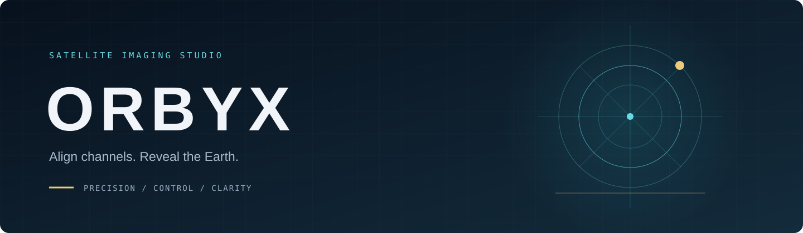

<p align="center"></p>

<p align="center"><a href="README.it.md">🇮🇹 Italiano</a> · <a href="README.md">🇬🇧 English</a></p>

<p align="center">
<a href="https://github.com/chiaraberti13/ORBYX/actions/workflows/ci.yml"></a>


</p>

> Allinea i canali. Rivela la Terra. Un ambiente desktop e headless indipendente per allineare i canali satellitari RDAS.

<p align="center"><a href="ROADMAP.md">Roadmap</a> · <a href="PROGRESS.md">Verifiche</a> · <a href="docs/AUDIT.md">Audit</a> · <a href="SECURITY.md">Sicurezza</a> · <a href="THIRD_PARTY_NOTICES.md">Attribuzioni</a></p>

## Inizia qui — Ubuntu

ORBYX è un programma con interfaccia grafica per allineare immagini satellitari e creare compositi Natural Color. Questa guida non richiede di conoscere CMake o di inserire percorsi personali.

**Copia un blocco di comandi alla volta.** Se un passaggio termina con un errore, fermati: non eseguire quello successivo.

### 1. Apri il terminale

Su Ubuntu premi **Ctrl + Alt + T**. Se hai già scaricato ORBYX, apri la sua cartella nel gestore file e scegli **Apri nel terminale**.

### 2. Scarica oppure aggiorna ORBYX

**Se è la prima volta**, esegui:

```bash
git clone https://github.com/chiaraberti13/ORBYX.git
cd ORBYX
```

Se compare «git: comando non trovato», installa Git e poi ripeti il blocco precedente:

```bash
sudo apt-get -o DPkg::Lock::Timeout=900 install -y git
```

**Se hai già scaricato ORBYX**, non clonarlo di nuovo. Dal terminale aperto nella cartella del progetto esegui soltanto:

```bash
git pull
```

### 3. Installa il programma

```bash
bash install.sh
```

- Lo script chiede la password Ubuntu per installare le dipendenze. Mentre la scrivi **non compaiono caratteri**: è normale; premi Invio.
- Non aggiungere `sudo` davanti a `bash install.sh`.
- Se sono in corso aggiornamenti automatici, lo script attende. Non cancellare blocchi e non terminare processi.
- L'installazione può richiedere diversi minuti. Configurazione, compilazione e test sono automatici.

**Controllo:** alla fine deve comparire **«Installazione completata»**. Se non compare, consulta la cartella **logs** prima di continuare.

### 4. Apri ORBYX

```bash
bash start.sh
```

Si apre la finestra del programma. Puoi avviarlo nuovamente con lo stesso comando; non devi reinstallarlo a ogni utilizzo. Per aggiornare il programma, chiudi prima ORBYX e ripeti `git pull` e `bash install.sh`.

### Quale pulsante premo? Guida rapida

Questa è la parte più importante: **ogni pulsante serve a una cosa diversa**. Guarda cosa hai a disposizione e usa **un solo** pulsante.

| La tua situazione | Premi questo | Cosa devi scegliere |
|---|---|---|
| **Voglio solo vedere come funziona** (non ho dati miei) | **Generazione automatica (1 clic)** | Niente. Parte da sola con le immagini di esempio. |
| **Ho 6 foto JPEG** chiamate `sx_`/`dx_` MSUGS-VIS-1/2/3 | **Crea immagine — modalità manuale…** | La cartella che contiene le 6 foto e una nuova destinazione. |
| **Ho dati veri decodificati da SatDump** | **Crea immagine — modalità manuale…** | Scegli tu la cartella che contiene **direttamente** `MSUGS_VIS1`, `MSUGS_VIS2`, ecc. Il profilo JSON viene proposto automaticamente, ma puoi cambiarlo. |
| **Ho già creato un risultato automatico e voglio correggerlo** | **Modifica il risultato nell’editor manuale…** | Nulla: vengono riaperte le porzioni appena elaborate. |

> **Non devi più scegliere fra due finestre manuali.** La modalità manuale riconosce
> sia i sei JPEG sia una cartella VIS esportata da SatDump e abilita soltanto i
> campi necessari. Se **Avanti** resta disabilitato, il messaggio nella stessa
> pagina indica esattamente quale file o cartella manca.

**Non sai da dove iniziare?** Premi **Generazione automatica**: è il modo più veloce per vedere subito un'immagine, senza impostare nulla. Appena finisce, il risultato compare da solo nell'anteprima.

### Non hai ancora dati? Prova la demo

```bash
bash demo.sh
```

Nell’app premi **Generazione automatica** (oppure **Ctrl+Maiusc+D**). Elabora i sei JPEG (tre SX e tre DX) presenti in una **cartella fissa** `~/.local/share/orbyx/auto-input`: allinea i canali, compone i colori e mostra un’unica immagine, **senza impostare alcun parametro**. Al primo avvio la cartella viene riempita automaticamente con i sei JPEG inclusi come esempio; per usare le tue immagini sostituiscile in quella cartella (nomi `sx_MSUGS-VIS-1/2/3.jpg` e `dx_MSUGS-VIS-1/2/3.jpg`) e premi di nuovo. Il percorso esatto compare nel riquadro Attività insieme a risultato e log.

Il comando qui sopra apre direttamente questa stessa demo; `bash demo.sh --no-open` la esegue senza finestra e salva in **demo-output**, con log in **logs**. I JPEG sono anteprime a 8 bit: la demo non certifica geometria assoluta o colore radiometricamente calibrato. [Provenienza e dettagli](assets/demo-jpeg/SOURCE.md).

**Modalità manuale:** premi **Crea immagine — modalità manuale…**, scegli la cartella con i sei JPEG e una nuova destinazione. Non servono dati RDAS né file `.json`; al termine si apre l’editor con le porzioni modificabili.

**Come funziona il profilo JSON:** con i sei JPEG non viene utilizzato e il campo è disattivato. Se scegli un’esportazione SatDump, ORBYX compila automaticamente **Profilo di calibrazione** con il JSON incluso. Non sei obbligata a mantenerlo: puoi scrivere un altro percorso nel campo oppure premere **Seleziona…** e scegliere un altro `calibration.json`. La cartella SatDump, invece, non viene scelta al posto tuo: devi selezionare tu la cartella del passaggio che contiene direttamente `MSUGS_VIS1`, `MSUGS_VIS2`, ecc.

### Nuove funzioni nell’app

- **Editor manuale**: aggiungi più porzioni come livelli, proponi automaticamente sovrapposizioni e ritaglio dei grandi bordi uniformi, controlla le giunzioni con sostituzione, sfumatura, percorso a costo minimo o blending multibanda, disegna maschere poligonali includi/escludi e uniforma luminosità e colore. Dopo un’elaborazione automatica il pulsante diventa **Modifica il risultato nell’editor manuale…**. [Guida passo passo](docs/COMPOSITOR.md).
- **Crea immagine — modalità manuale…**: un unico percorso guidato accetta i sei JPEG oppure i prodotti VIS esportati da SatDump, riconosce il contenuto, consente di cambiare origine e nuova destinazione, elabora e apre automaticamente l’editor. Per SatDump scegli personalmente la cartella di origine; ORBYX propone il JSON incluso, che rimane modificabile o sostituibile. Il profilo JSON e il satellite sono richiesti soltanto per i dati SatDump.

- **Calibrazione guidata…**: scegli dati e destinazione, controlla satellite e scala, poi avvia il calcolo. Il nuovo profilo viene selezionato per l’allineamento.
- **SatDump**: ORBYX segnala se trova l’eseguibile, ma lavora sulla **cartella esportata**. Non controlla SatDump e non apre direttamente CADU o altri dati grezzi. In **Mostra strumenti avanzati** puoi usare **Monitora acquisizioni…** su una cartella in cui SatDump salva i prodotti.
- La coda viene conservata alla chiusura. Alla riapertura i risultati sono **Da verificare** finché la ripresa non riconferma i digest. Un doppio click su un lavoro ne mostra i parametri.
- **Aggiornamenti verificati…**: installa un pacchetto con provenienza firmata o ripristina la versione precedente. [Guida semplice](docs/UPDATES.md).

Per controllare le vulnerabilità delle librerie installate:

```bash
bash security.sh
```

Report e diagnostica sono in **logs**. La scansione consulta i dati Ubuntu in OSV e indica anche eventuali parti non verificabili. [Dettagli](docs/SBOM.md).

### 5. Elabora le tue immagini

Per elaborare servono prodotti RDAS **già decodificati da SatDump**, con i due sensori VIS e i relativi canali. ORBYX non riceve direttamente il segnale satellitare. Puoi comunque installare e aprire il programma anche senza dati.

Nella finestra:

1. Premi **Seleziona…** accanto alla cartella di origine e scegli il prodotto decodificato.
2. Scegli il satellite corretto. Lascia il profilo proposto se contiene la calibrazione del tuo satellite.
3. Scegli una **nuova cartella di destinazione**. ORBYX conserva gli originali e rifiuta di sovrascrivere risultati esistenti.
4. Scegli **Allinea canali**, poi **Avvia elaborazione**.
5. Attendi **Completato**; usa l'anteprima e il riquadro Attività per controllare il risultato.

**Se usi L4:** premi **Calibrazione guidata…**, segui i tre passaggi e avvia il calcolo. Dopo il successo l’app seleziona il nuovo profilo e prepara la modalità **Allinea canali** con una nuova destinazione; controlla i parametri e premi **Avvia elaborazione**. La scelta delle regioni di fusione rimane manuale: [dettagli sulla calibrazione reale](docs/REAL_RDAS.md).

### 6. Esporta Natural Color

Dopo l'allineamento premi **Esporta Natural Color…**, scegli la cartella di un singolo VIS allineato e il nome di un nuovo PNG. L'esportazione mantiene la profondità a 8 o 16 bit. È una resa visiva, non una misura scientifica del colore.

### 7. Se compare un errore

| Messaggio | Cosa fare |
|---|---|
| Gestore pacchetti occupato / unattended-upgrades | Lascia terminare gli aggiornamenti. L'installer attende; se termina per timeout, ripeti `bash install.sh` più tardi. |
| cmake, ctest o dipendenza non trovata | Esegui `bash install.sh`; installare soltanto CMake non basta. |
| Installazione incompleta / eseguibile assente | Completa prima `bash install.sh`. Avvia con `bash start.sh`, senza cercare manualmente i binari. |
| Destinazione già esistente | Scegli una nuova cartella o un nuovo nome di file. |
| Test SBOM: «no NEEDED libraries» su sistema italiano | Aggiorna con `git pull` e ripeti `bash install.sh`: la lettura delle librerie ora è indipendente dalla lingua. |
| Altro errore | Apri **logs**: trovi il log completo e il corrispondente `.errors.log` dell'ultima esecuzione. |

I log di installazione e avvio restano locali, sono esclusi da git e non vengono inviati automaticamente. [Guida agli errori di installazione](docs/INSTALLATION.md).

## Per chi vuole usare il terminale

Dopo l'installazione:

```bash
bash orbyx.sh --lang it --help
bash orbyx.sh --version
```

Per iniziare non è necessario usare i comandi di elaborazione: puoi scegliere dati e destinazioni dalla finestra.

## Informazioni sul progetto

- [Funzioni ancora da completare](ROADMAP.md) e [lavoro già verificato](PROGRESS.md).
- [Verifiche su dati reali, piattaforme e limiti](docs/VERIFICATION_STATUS.md). GPU effettiva e geometria assoluta non sono certificate.
- [Elaborazione batch](docs/BATCH.md), [Natural Color](docs/NATURAL_COLOR.md) e [architettura](docs/ADR-001-language.md).
- [Segnalazioni di sicurezza](SECURITY.md).

ORBYX deriva dal progetto [RDAS Layer Aligner di Digitelektro](https://github.com/Digitelektro/rdas_layer_aligner), con core C++17/OpenCV e desktop Qt6. Licenza [GPLv3](LICENSE); [attribuzioni e componenti di terzi](THIRD_PARTY_NOTICES.md). I dati e i profili originali restano separati dai risultati.
