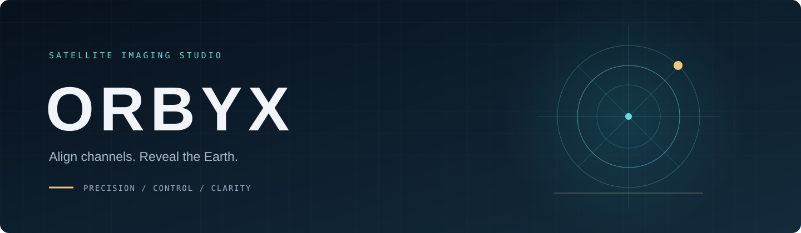

<p align="center"></p>

<p align="center"><a href="README.it.md">🇮🇹 Italiano</a> · <a href="README.md">🇬🇧 English</a></p>

<p align="center">
<a href="https://github.com/chiaraberti13/ORBYX/actions/workflows/ci.yml"></a>


</p>

> **Allinea i canali. Rivela la Terra.** Da sei immagini grezze a una sola foto del pianeta a colori naturali.

<p align="center"><a href="ROADMAP.md">Roadmap</a> · <a href="PROGRESS.md">Verifiche</a> · <a href="docs/GUIDA_PRINCIPIANTI.md">Guida per principianti</a> · <a href="SECURITY.md">Sicurezza</a> · <a href="THIRD_PARTY_NOTICES.md">Attribuzioni</a></p>

---

## Cos'è ORBYX

ORBYX trasforma i dati grezzi dei satelliti meteo geostazionari russi **Elektro‑L** e **Arktika‑M** in una **singola immagine della Terra a colori naturali**.

Il sensore a bordo (MSU‑GS) non fotografa a colori: acquisisce **tre canali separati in bianco e nero**, divisi per di più in **due metà**. ORBYX li rimette insieme: **allinea** i canali al pixel, **unisce** le due metà, raddrizza l'immagine con il **Nord in alto** e compone il **colore naturale**. Il tutto con **un clic**, oppure a mano quando vuoi il controllo totale.

**In parole semplici:** gli dai le immagini in bianco e nero appena ricevute dal satellite e lui ti restituisce **una foto a colori del nostro pianeta**, pronta da guardare e condividere.

### Come funziona, in 3 passi

| 1. Ricezione e decodifica | 2. ORBYX | 3. Il tuo risultato |
|---|---|---|
| **SatDump** (programma esterno) riceve il segnale e lo decodifica nei canali grezzi. | **ORBYX** allinea i canali, unisce le due metà, ruota a Nord e compone il colore. | Ottieni **una sola immagine**: un **JPG** leggero (si apre ovunque) e un **PNG** a piena qualità. |

> ⓘ ORBYX **non** riceve il segnale radio e **non** decodifica il CADU: quello è compito di SatDump. ORBYX parte dalle immagini **già esportate** da SatDump.

---

## Installazione (Ubuntu)

Non serve conoscere CMake né scrivere percorsi. **Copia un blocco alla volta.** Se un passaggio finisce con un errore, fermati e guarda la cartella `logs`.

**1. Apri il terminale** — premi `Ctrl + Alt + T`.

**2. Scarica ORBYX**

```bash
git clone https://github.com/chiaraberti13/ORBYX.git
cd ORBYX
```

Se compare «git: comando non trovato», installalo e ripeti il blocco:

```bash
sudo apt-get -o DPkg::Lock::Timeout=900 install -y git
```

**3. Installa**

```bash
bash install.sh
```

- Ti verrà chiesta la password di Ubuntu: mentre la digiti **non compaiono caratteri**, è normale — premi Invio.
- **Non** mettere `sudo` davanti a `bash install.sh`.
- Se sono in corso aggiornamenti di sistema, lo script attende: non interromperlo.
- Dura qualche minuto (configura, compila e verifica). Vai avanti solo quando leggi **«Installazione completata»**.

**4. Apri ORBYX**

```bash
bash start.sh
```

> 🔄 **Per aggiornare:** chiudi ORBYX, poi `git pull` e di nuovo `bash install.sh`.

---

## Il tuo primo risultato

### Via più semplice — Generazione automatica (1 clic)

1. In ORBYX premi **«Apri cartella file di origine»**: si apre una cartella.
2. Mettici dentro **le tue immagini**, in uno di questi due modi:
   - un'esportazione SatDump — le due cartelle **`MSUGS_VIS1`** e **`MSUGS_VIS2`** con i loro `MSUGS-VIS-1/2/3` (è il caso normale);
   - oppure i sei file `sx_MSUGS-VIS-1/2/3` e `dx_MSUGS-VIS-1/2/3`.
3. Scegli il **satellite** in alto (predefinito **L3**).
4. Premi **«Generazione automatica (1 clic)»** (o `Ctrl + Maiusc + D`).

ORBYX fa tutto da solo — calibra i canali sui tuoi dati, li allinea, unisce le metà, ruota a Nord e compone il colore — e al termine **mostra l'immagine nell'anteprima**. La trovi con **«Apri immagini generate»**.

> ⓘ La Generazione automatica elabora **sempre e solo le immagini che metti tu** nella cartella di origine. Non esiste una «demo» separata: se la cartella è vuota, ORBYX te lo dice e non genera nulla finta.

### Quale pulsante premo?

Ogni pulsante fa una cosa diversa: guarda cosa hai e usane **uno solo**.

| La tua situazione | Premi | Cosa scegli |
|---|---|---|
| **Ho un'esportazione SatDump** (`MSUGS_VIS1` + `MSUGS_VIS2`) | **Generazione automatica (1 clic)** | Solo il satellite. Il resto è automatico. |
| **Voglio comporre o ritoccare a mano** | **Crea immagine — modalità manuale…** | La cartella di origine e una nuova destinazione. |
| **Ho già un risultato automatico e voglio correggerlo** | **Modifica il risultato nell'editor manuale…** | Nulla: riapre le porzioni appena elaborate. |

> La modalità manuale è **una sola finestra**: riconosce da sola se le hai dato i canali o un'esportazione SatDump e abilita solo i campi utili. Se **Avanti** resta spento, il messaggio nella pagina dice esattamente cosa manca.

---

## Quali file servono? PNG o JPG

Puoi usare sia **PNG** sia **JPG/JPEG**: ORBYX accetta entrambi, sia in automatico sia in manuale. Ma c'è una differenza che conta:

- 🟢 **PNG** — è il formato originale che esce da SatDump. Conserva **tutte le sfumature** dei dati ed è **senza perdita**: è la scelta giusta quando vuoi la **qualità migliore**.
- 🟡 **JPG/JPEG** — è più leggero, ma «comprime» buttando via un po' di informazione. Va benissimo per una **prova veloce** o per immagini che hai già in JPG; però parte da una base più povera e può lasciare piccoli aloni ai bordi.

**In breve: PNG quando conta la qualità, JPG quando conta la praticità.**

---

## Cosa ottieni

Nella cartella del risultato (apribile con **«Apri immagini generate»**) trovi:

- **`composite.jpg`** — leggero (~20 MB), si apre **ovunque** all'istante: perfetto per guardarlo e condividerlo.
- **`composite.png`** — a 8 bit, è la versione **a qualità piena** da conservare.

Entrambe sono a **piena risoluzione** (segue le dimensioni delle tue immagini, non è fissa) e con il **Nord in alto**.

---

## Funzioni per utenti esperti

In **«Mostra strumenti avanzati»** trovi le funzioni di controllo fine:

- **Compositore porzioni e colore** — più porzioni come livelli, proposta automatica delle sovrapposizioni, controllo delle giunzioni (sostituzione, sfumatura, costura a costo minimo, blending multibanda), maschere includi/escludi, uniforma luminosità e colore, istogramma e valutazione qualità. Progetto salvabile e riapribile. [Guida](docs/COMPOSITOR.md).
- **Crea immagine — modalità manuale** — un percorso guidato in cinque passi: Importa → Allinea → Unisci → Colore → Esporta.
- **Calibrazione guidata** — ricalcola l'allineamento dei canali sui tuoi dati (utile soprattutto per L4, che non ha un profilo incluso). [Dettagli](docs/REAL_RDAS.md).
- **Monitora acquisizioni** — rileva i nuovi prodotti SatDump in una cartella; l'importazione resta sempre manuale.
- **Esporta Natural Color** — compone il colore di un singolo VIS allineato in un PNG (8/16 bit).
- **Aggiornamenti verificati** — installa o ripristina una versione con provenienza firmata. [Guida](docs/UPDATES.md).

Controllo delle vulnerabilità delle librerie installate:

```bash
bash security.sh
```

Report e diagnostica finiscono nella cartella `logs`. [Dettagli](docs/SBOM.md).

---

## Suggerimenti

- 🛈 **Satellite giusto.** Per un'esportazione Elektro‑L3 scegli **L3**; per altri satelliti scegli il loro codice (L2/L4/L5/M1/M2). Un satellite sbagliato dà un allineamento sbagliato.
- 🛈 **Usa il PNG** per i dati veri: è senza perdita. Tieni il JPG per le prove o se li hai già convertiti.
- 🛈 **Non sovrascrive mai.** Ogni risultato va in una cartella nuova; gli originali restano intatti.
- 🛈 **La prima volta è più lenta** (la calibrazione sui tuoi dati richiede ~20 secondi): è normale.
- 🛈 **L'anteprima è ridotta**, ma le immagini **esportate** sono a piena risoluzione.

---

## Se qualcosa non va

| Messaggio | Cosa fare |
|---|---|
| **Gestore pacchetti occupato / unattended‑upgrades** | Lascia finire gli aggiornamenti e ripeti `bash install.sh` più tardi. Non rimuovere i lock. |
| **cmake / ctest / dipendenza non trovata** | Esegui `bash install.sh`: installare solo CMake non basta. |
| **Installazione incompleta / eseguibile assente** | Completa `bash install.sh`, poi avvia con `bash start.sh`. |
| **Destinazione già esistente** | Scegli una nuova cartella o un nuovo nome. |
| **La cartella di origine è vuota** | Metti dentro `MSUGS_VIS1` e `MSUGS_VIS2` (o i sei file `sx_/dx_`) e riprova. |
| **Altro errore** | Apri `logs`: trovi il log completo e il relativo `.errors.log`. |

I log restano **locali**, sono esclusi da git e non vengono inviati da nessuna parte. [Guida agli errori](docs/INSTALLATION.md).

---

## Da terminale (opzionale)

Non serve per iniziare: puoi fare tutto dalla finestra. Ma se preferisci la riga di comando:

```bash
bash orbyx.sh --lang it --help
bash orbyx.sh --version
```

---

## Cosa ORBYX fa e cosa **non** fa

Per chiarezza — ORBYX dichiara solo ciò che fa davvero:

- ✅ Allinea i canali, unisce le due metà e compone il colore naturale, in automatico o a mano.
- ✅ Esporta a piena risoluzione (JPG + PNG), con il Nord in alto.
- ❌ **Non** riceve il segnale satellitare e **non** decodifica il CADU: lo fa **SatDump**, a monte.
- ❌ Il colore è una **resa visiva** gradevole, **non** un colore scientifico calibrato.
- ❌ **Non** georeferenzia: niente coordinate assolute né proiezione cartografica.
- ❌ Testato su **Linux (Ubuntu)**; altre piattaforme non sono garantite.

---

## Informazioni sul progetto

- [Verifiche su dati reali, piattaforme e limiti](docs/VERIFICATION_STATUS.md)
- [Natural Color](docs/NATURAL_COLOR.md) · [Elaborazione batch](docs/BATCH.md) · [Architettura](docs/ADR-001-language.md)
- [Segnalazioni di sicurezza](SECURITY.md)

ORBYX deriva dal progetto [RDAS Layer Aligner di Digitelektro](https://github.com/Digitelektro/rdas_layer_aligner), con core C++17/OpenCV e desktop Qt 6. Licenza [GPLv3](LICENSE); [attribuzioni e componenti di terzi](THIRD_PARTY_NOTICES.md). I dati e i profili originali restano sempre separati dai risultati.

## Comunità e collaborazione

- [Come contribuire](CONTRIBUTING.md)
- [Codice di condotta](CODE_OF_CONDUCT.md)
- [Segnalazioni di sicurezza](SECURITY.md)
- [Accessibilità e limiti delle verifiche](ACCESSIBILITY.md)
- [Segnalare un problema o proporre un miglioramento](https://github.com/chiaraberti13/ORBYX/issues/new/choose)
- [Licenza del progetto](LICENSE)
