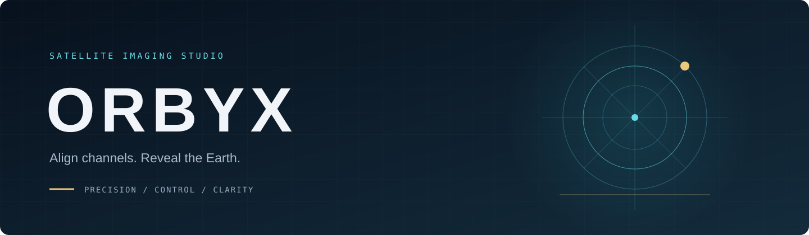

<p align="center"></p>

<p align="center"><a href="README.md">🇮🇹 Italiano</a> · <a href="README.en.md">🇬🇧 English</a></p>

<p align="center">
<a href="https://github.com/chiaraberti13/ORBYX/actions/workflows/ci.yml"></a>


</p>

> Allinea i canali. Rivela la Terra. Un ambiente desktop e headless indipendente per allineare i canali satellitari RDAS.

<p align="center"><a href="ROADMAP.md">Roadmap</a> · <a href="PROGRESS.md">Verifiche</a> · <a href="docs/AUDIT.md">Audit</a> · <a href="SECURITY.md">Sicurezza</a> · <a href="THIRD_PARTY_NOTICES.md">Attribuzioni</a></p>

## Inizia qui — Ubuntu

ORBYX è un programma con interfaccia grafica per allineare immagini satellitari e creare compositi Natural Color. Questa guida non richiede di conoscere CMake o di inserire percorsi personali.

**Copia un blocco di comandi alla volta.** Se un passaggio termina con un errore, fermati: non eseguire quello successivo.

### 1. Apri il terminale

Su Ubuntu premi **Ctrl + Alt + T**. Se hai già scaricato ORBYX, apri la sua cartella nel gestore file e scegli **Apri nel terminale**.

### 2. Scarica oppure aggiorna ORBYX

**Se è la prima volta**, esegui:

```bash
git clone https://github.com/chiaraberti13/ORBYX.git
cd ORBYX
```

Se compare «git: comando non trovato», installa Git e poi ripeti il blocco precedente:

```bash
sudo apt-get -o DPkg::Lock::Timeout=900 install -y git
```

**Se hai già scaricato ORBYX**, non clonarlo di nuovo. Dal terminale aperto nella cartella del progetto esegui soltanto:

```bash
git pull
```

### 3. Installa il programma

```bash
bash install.sh
```

- Lo script chiede la password Ubuntu per installare le dipendenze. Mentre la scrivi **non compaiono caratteri**: è normale; premi Invio.
- Non aggiungere `sudo` davanti a `bash install.sh`.
- Se sono in corso aggiornamenti automatici, lo script attende. Non cancellare blocchi e non terminare processi.
- L'installazione può richiedere diversi minuti. Configurazione, compilazione e test sono automatici.

**Controllo:** alla fine deve comparire **«Installazione completata»**. Se non compare, consulta la cartella **logs** prima di continuare.

### 4. Apri ORBYX

```bash
bash start.sh
```

Si apre la finestra del programma. Puoi avviarlo nuovamente con lo stesso comando; non devi reinstallarlo a ogni utilizzo. Per aggiornare il programma, chiudi prima ORBYX e ripeti `git pull` e `bash install.sh`.

### Non hai ancora dati? Prova la demo

```bash
bash demo.sh
```

Nell’app premi **Generazione automatica** (oppure **Ctrl+Maiusc+D**). Elabora i sei JPEG (tre SX e tre DX) presenti in una **cartella fissa** `~/.local/share/orbyx/auto-input`: allinea i canali, compone i colori e mostra un’unica immagine, **senza impostare alcun parametro**. Al primo avvio la cartella viene riempita automaticamente con i sei JPEG inclusi come esempio; per usare le tue immagini sostituiscile in quella cartella (nomi `sx_MSUGS-VIS-1/2/3.jpg` e `dx_MSUGS-VIS-1/2/3.jpg`) e premi di nuovo.

I risultati automatici e manuali finiscono per impostazione predefinita nella cartella visibile **Immagini/ORBYX/Output Images**. I profili JSON si trovano in **Immagini/ORBYX/Calibration**: quello incluso è `included-calibration.json`, mentre una nuova calibrazione crea una sottocartella e mostra nell’interfaccia il percorso completo del nuovo `calibration.json`. I log delle elaborazioni immagini sono in **Immagini/ORBYX/Logs**. Su sistemi in lingua inglese la cartella di sistema può chiamarsi `Pictures` invece di `Immagini`.

Il comando qui sopra apre direttamente questa stessa demo; `bash demo.sh --no-open` la esegue senza finestra e salva in **demo-output**, con log in **logs**. I JPEG sono anteprime a 8 bit: la demo non certifica geometria assoluta o colore radiometricamente calibrato. [Provenienza e dettagli](assets/demo-jpeg/SOURCE.md).

**Simulazione manuale:** premi **Simulazione immagini…** (oppure **Ctrl+Maiusc+S**) per eseguire la stessa elaborazione scegliendo tu la cartella: parte dalla cartella demo inclusa, ma puoi indicarne una tua con sei JPEG chiamati `sx_MSUGS-VIS-1/2/3.jpg` e `dx_MSUGS-VIS-1/2/3.jpg`. Non servono dati RDAS né file `.json`.

**Niente file JSON da caricare:** il **Profilo di calibrazione** è già incluso e preselezionato (lo vedi scritto «(incluso)»). Normalmente scegli solo la **Cartella RDAS di origine** e una **Nuova cartella di destinazione**; il profilo lo lasci com’è. Se lo svuoti per errore, l’app rimette da sola quello incluso.

### Nuove funzioni nell’app

- **Componi porzioni e colore…**: aggiungi più porzioni come livelli, proponi automaticamente sovrapposizioni e ritaglio dei grandi bordi uniformi, controlla le giunzioni con sostituzione, sfumatura, percorso a costo minimo o blending multibanda, disegna maschere poligonali includi/escludi, uniforma visualmente luminosità e colore fra livelli, usa i preset di canale singolo, leggi istogramma e clipping e una valutazione qualità che non dichiara mai «perfetta» un’immagine. Salva un progetto portabile (percorsi relativi) con autosalvataggio e recupero, esportalo come pacchetto autonomo ed esporta un solo PNG con report riproducibile. Dopo **Genera**, le porzioni allineate vengono aperte direttamente con le ROI del profilo come punto di partenza modificabile, senza alterare il risultato storico. Non è limitato a SX/DX. [Guida passo passo](docs/COMPOSITOR.md).
- **Crea immagine finale…**: percorso guidato in cinque passaggi per principianti. Seleziona la cartella esportata da SatDump che contiene direttamente `MSUGS_VIS1`, `MSUGS_VIS2`, ecc.; la cartella generica Documenti e la demo dei sei JPEG non sono ingressi validi per questo percorso. Controlla allineamento/unione/colore, avvia l’elaborazione e apre automaticamente l’editor sul risultato, senza cercare file intermedi. Se il contenuto non è valido, il primo passaggio mostra ora l’errore preciso accanto ai campi.

- **Calibrazione guidata…**: scegli dati e destinazione, controlla satellite e scala, poi avvia il calcolo. Il nuovo profilo viene selezionato per l’allineamento.
- **Monitora acquisizioni…**: scegli la cartella di SatDump. Puoi importare un prodotto pronto o attivare l’accodamento automatico dei prodotti compatibili; l’elaborazione parte solo con **Avvia coda**.
- La coda viene conservata alla chiusura. Alla riapertura i risultati sono **Da verificare** finché la ripresa non riconferma i digest. Un doppio click su un lavoro ne mostra i parametri.
- **Aggiornamenti verificati…**: installa un pacchetto con provenienza firmata o ripristina la versione precedente. [Guida semplice](docs/UPDATES.md).

Per controllare le vulnerabilità delle librerie installate:

```bash
bash security.sh
```

Report e diagnostica sono in **logs**. La scansione consulta i dati Ubuntu in OSV e indica anche eventuali parti non verificabili. [Dettagli](docs/SBOM.md).

### 5. Elabora le tue immagini

Per elaborare servono prodotti RDAS **già decodificati da SatDump**, con i due sensori VIS e i relativi canali. ORBYX non riceve direttamente il segnale satellitare. Puoi comunque installare e aprire il programma anche senza dati.

Nella finestra:

1. Premi **Seleziona…** accanto alla cartella di origine e scegli il prodotto decodificato.
2. Scegli il satellite corretto. Lascia il profilo proposto se contiene la calibrazione del tuo satellite.
3. Scegli una **nuova cartella di destinazione**. ORBYX conserva gli originali e rifiuta di sovrascrivere risultati esistenti.
4. Scegli **Allinea canali**, poi **Avvia elaborazione**.
5. Attendi **Completato**; usa l'anteprima e il riquadro Attività per controllare il risultato.

**Se usi L4:** premi **Calibrazione guidata…**, segui i tre passaggi e avvia il calcolo. Dopo il successo l’app seleziona il nuovo profilo e prepara la modalità **Allinea canali** con una nuova destinazione; controlla i parametri e premi **Avvia elaborazione**. La scelta delle regioni di fusione rimane manuale: [dettagli sulla calibrazione reale](docs/REAL_RDAS.md).

### 6. Esporta Natural Color

Dopo l'allineamento premi **Esporta Natural Color…**, scegli la cartella di un singolo VIS allineato e il nome di un nuovo PNG. L'esportazione mantiene la profondità a 8 o 16 bit. È una resa visiva, non una misura scientifica del colore.

### 7. Se compare un errore

| Messaggio | Cosa fare |
|---|---|
| Gestore pacchetti occupato / unattended-upgrades | Lascia terminare gli aggiornamenti. L'installer attende; se termina per timeout, ripeti `bash install.sh` più tardi. |
| cmake, ctest o dipendenza non trovata | Esegui `bash install.sh`; installare soltanto CMake non basta. |
| Installazione incompleta / eseguibile assente | Completa prima `bash install.sh`. Avvia con `bash start.sh`, senza cercare manualmente i binari. |
| Destinazione già esistente | Scegli una nuova cartella o un nuovo nome di file. |
| Test SBOM: «no NEEDED libraries» su sistema italiano | Aggiorna con `git pull` e ripeti `bash install.sh`: la lettura delle librerie ora è indipendente dalla lingua. |
| Altro errore | Apri **logs**: trovi il log completo e il corrispondente `.errors.log` dell'ultima esecuzione. |

I log di installazione e avvio restano locali, sono esclusi da git e non vengono inviati automaticamente. [Guida agli errori di installazione](docs/INSTALLATION.md).

## Per chi vuole usare il terminale

Dopo l'installazione:

```bash
bash orbyx.sh --lang it --help
bash orbyx.sh --version
```

Per iniziare non è necessario usare i comandi di elaborazione: puoi scegliere dati e destinazioni dalla finestra.

## Informazioni sul progetto

- [Funzioni ancora da completare](ROADMAP.md) e [lavoro già verificato](PROGRESS.md).
- [Verifiche su dati reali, piattaforme e limiti](docs/VERIFICATION_STATUS.md). GPU effettiva e geometria assoluta non sono certificate.
- [Elaborazione batch](docs/BATCH.md), [Natural Color](docs/NATURAL_COLOR.md) e [architettura](docs/ADR-001-language.md).
- [Segnalazioni di sicurezza](SECURITY.md).

ORBYX deriva dal progetto [RDAS Layer Aligner di Digitelektro](https://github.com/Digitelektro/rdas_layer_aligner), con core C++17/OpenCV e desktop Qt6. Licenza [GPLv3](LICENSE); [attribuzioni e componenti di terzi](THIRD_PARTY_NOTICES.md). I dati e i profili originali restano separati dai risultati.
