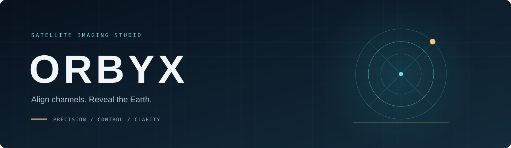

<p align="center"></p>

<p align="center"><a href="README.it.md">🇮🇹 Italiano</a> · <a href="README.md">🇬🇧 English</a></p>

<p align="center">
<a href="https://github.com/chiaraberti13/ORBYX/actions/workflows/ci.yml"></a>


</p>

> **Align the channels. Reveal the Earth.** From six raw frames to a single natural‑colour image of the planet.

<p align="center"><a href="ROADMAP.md">Roadmap</a> · <a href="PROGRESS.md">Verification</a> · <a href="docs/GUIDA_PRINCIPIANTI.md">Beginner guide</a> · <a href="SECURITY.md">Security</a> · <a href="THIRD_PARTY_NOTICES.md">Attributions</a></p>

---

## What is ORBYX

ORBYX turns the raw data of the Russian geostationary weather satellites **Elektro‑L** and **Arktika‑M** into a **single natural‑colour image of the Earth**.

The onboard sensor (MSU‑GS) does not shoot in colour: it captures **three separate black‑and‑white channels**, each split into **two halves**. ORBYX puts them back together: it **aligns** the channels to the pixel, **joins** the two halves, turns the image **North‑up** and composes **natural colour** — in **one click**, or by hand when you want full control.

**In plain words:** you give it the black‑and‑white frames the satellite just sent, and it gives you back **a colour photo of our planet**, ready to look at and share.

### How it works, in 3 steps

| 1. Reception & decoding | 2. ORBYX | 3. Your result |
|---|---|---|
| **SatDump** (external program) receives the signal and decodes it into raw channels. | **ORBYX** aligns the channels, joins the two halves, rotates North‑up and composes colour. | You get **one image**: a lightweight **JPG** (opens anywhere) and a full‑quality **PNG**. |

> ⓘ ORBYX does **not** receive the radio signal and does **not** decode the CADU: that is SatDump's job. ORBYX starts from the images SatDump has **already exported**.

---

## Installation (Ubuntu)

No CMake knowledge and no personal paths required. **Run one block at a time.** If a step ends with an error, stop and check the `logs` folder.

**1. Open a terminal** — press `Ctrl + Alt + T`.

**2. Download ORBYX**

```bash
git clone https://github.com/chiaraberti13/ORBYX.git
cd ORBYX
```

If you see "git: command not found", install it and repeat the block:

```bash
sudo apt-get -o DPkg::Lock::Timeout=900 install -y git
```

**3. Install**

```bash
bash install.sh --lang en
```

- You will be asked for your Ubuntu password: while you type it **no characters appear**, that is normal — press Enter.
- Do **not** put `sudo` in front of `bash install.sh`.
- If system updates are running, the script waits: do not interrupt it.
- It takes a few minutes (configure, build, verify). Continue only when you read **"Installation completed"**.

**4. Open ORBYX**

```bash
bash start.sh
```

> 🔄 **To update:** close ORBYX, then `git pull` and run `bash install.sh` again.

---

## Your first result

### The simplest path — Automatic generation (1 click)

1. In ORBYX press **"Open source files folder"**: a folder opens.
2. Put **your own images** in it, in one of two ways:
   - a SatDump export — the two folders **`MSUGS_VIS1`** and **`MSUGS_VIS2`** with their `MSUGS-VIS-1/2/3` (the usual case);
   - or the six files `sx_MSUGS-VIS-1/2/3` and `dx_MSUGS-VIS-1/2/3`.
3. Pick the **satellite** at the top (default **L3**).
4. Press **"Automatic generation (1 click)"** (or `Ctrl + Shift + D`).

ORBYX does everything by itself — calibrates the channels on your data, aligns them, joins the halves, rotates North‑up and composes colour — and shows the **image in the preview** when done. Find it with **"Open generated images"**.

> ⓘ Automatic generation **only ever processes the images you put** in the source folder. There is no separate "demo": if the folder is empty, ORBYX tells you and generates nothing fake.

### Which button do I press?

Each button does a different thing: look at what you have and use **one**.

| Your situation | Press | What you choose |
|---|---|---|
| **I have a SatDump export** (`MSUGS_VIS1` + `MSUGS_VIS2`) | **Automatic generation (1 click)** | Just the satellite. The rest is automatic. |
| **I want to compose or retouch by hand** | **Create image — manual mode…** | The source folder and a new destination. |
| **I already have an automatic result and want to fix it** | **Edit the result in the manual editor…** | Nothing: it reopens the portions just processed. |

> Manual mode is **a single window**: it detects whether you gave it the channels or a SatDump export and enables only the useful fields. If **Next** stays disabled, the message on the page says exactly what is missing.

---

## Which files do I need? PNG or JPG

You can use **PNG** or **JPG/JPEG**: ORBYX accepts both, in automatic and manual mode. But there is a difference that matters:

- 🟢 **PNG** — the original format SatDump exports. It keeps **all the shades** of the data and is **lossless**: the right choice when you want the **best quality**.
- 🟡 **JPG/JPEG** — lighter, but it "compresses" by throwing away some information. Fine for a **quick try** or for images you already have as JPG; but it starts from a poorer base and can leave faint halos at the edges.

**In short: PNG when quality matters, JPG when convenience matters.**

---

## What you get

In the result folder (open it with **"Open generated images"**) you find:

- **`composite.jpg`** — lightweight (~20 MB), opens **anywhere** instantly: perfect to view and share.
- **`composite.png`** — 8‑bit, the **full‑quality** version to keep.

Both are **full resolution** (it follows your images' size, it is not fixed) and **North‑up**.

---

## For advanced users

Under **"Show advanced tools"** you find the fine‑control features:

- **Portion and colour compositor** — several portions as layers, automatic overlap proposals, junction control (replace, feather, minimum‑cost seam, multiband blending), include/exclude masks, brightness/colour matching, histogram and a quality assessment. Project is saved and reopenable. [Guide](docs/COMPOSITOR.md).
- **Create image — manual mode** — a five‑step guided path: Import → Align → Join → Colour → Export.
- **Guided calibration** — recomputes the channel alignment on your data (useful above all for L4, which has no bundled profile). [Details](docs/REAL_RDAS.md).
- **Monitor acquisitions** — detects new SatDump products in a folder; import always stays manual.
- **Export Natural Color** — composes the colour of a single aligned VIS into a PNG (8/16‑bit).
- **Verified updates** — install or roll back a version with signed provenance. [Guide](docs/UPDATES.md).

Scan the installed libraries for vulnerabilities:

```bash
bash security.sh
```

Reports and diagnostics go to the `logs` folder. [Details](docs/SBOM.md).

---

## Tips

- 🛈 **Right satellite.** For an Elektro‑L3 export choose **L3**; for other satellites choose their code (L2/L4/L5/M1/M2). The wrong satellite gives the wrong alignment.
- 🛈 **Use PNG** for real data: it is lossless. Keep JPG for quick tries or if you already converted them.
- 🛈 **It never overwrites.** Every result goes to a new folder; originals stay untouched.
- 🛈 **The first run is slower** (calibrating on your data takes ~20 seconds): that is normal.
- 🛈 **The preview is reduced**, but the **exported** images are full resolution.

---

## If something goes wrong

| Message | What to do |
|---|---|
| **Package manager busy / unattended‑upgrades** | Let updates finish and repeat `bash install.sh` later. Do not remove locks. |
| **cmake / ctest / dependency not found** | Run `bash install.sh`: installing CMake alone is not enough. |
| **Incomplete installation / missing executable** | Finish `bash install.sh`, then launch with `bash start.sh`. |
| **Destination already exists** | Choose a new folder or a new name. |
| **The source folder is empty** | Put `MSUGS_VIS1` and `MSUGS_VIS2` (or the six `sx_/dx_` files) in it and retry. |
| **Other error** | Open `logs`: you find the full log and its `.errors.log`. |

Logs stay **local**, are ignored by git and are never uploaded. [Error guide](docs/INSTALLATION.md).

---

## Command line (optional)

Not needed to start — you can do everything from the window. But if you prefer the command line:

```bash
bash orbyx.sh --help
bash orbyx.sh --version
```

---

## What ORBYX does and does **not** do

For clarity — ORBYX only claims what it really does:

- ✅ Aligns the channels, joins the two halves and composes natural colour, automatically or by hand.
- ✅ Exports at full resolution (JPG + PNG), North‑up.
- ❌ Does **not** receive the satellite signal and does **not** decode the CADU: **SatDump** does that upstream.
- ❌ The colour is a pleasant **visual rendering**, **not** scientifically calibrated true colour.
- ❌ Does **not** georeference: no absolute coordinates and no map projection.
- ❌ Tested on **Linux (Ubuntu)**; other platforms are not guaranteed.

---

## Project information

- [Verification on real data, platforms and limits](docs/VERIFICATION_STATUS.md)
- [Natural Color](docs/NATURAL_COLOR.md) · [Batch processing](docs/BATCH.md) · [Architecture](docs/ADR-001-language.en.md)
- [Security reports](SECURITY.md)

ORBYX derives from [Digitelektro's RDAS Layer Aligner](https://github.com/Digitelektro/rdas_layer_aligner), with a C++17/OpenCV core and a Qt 6 desktop. Licensed under [GPLv3](LICENSE); [third‑party notices](THIRD_PARTY_NOTICES.md). Original data and profiles always stay separate from results.

## Community and collaboration

- [Contributing](CONTRIBUTING.md)
- [Code of conduct](CODE_OF_CONDUCT.md)
- [Security reports](SECURITY.md)
- [Accessibility and verification limits](ACCESSIBILITY.md)
- [Report a problem or propose an improvement](https://github.com/chiaraberti13/ORBYX/issues/new/choose)
- [Project license](LICENSE)
