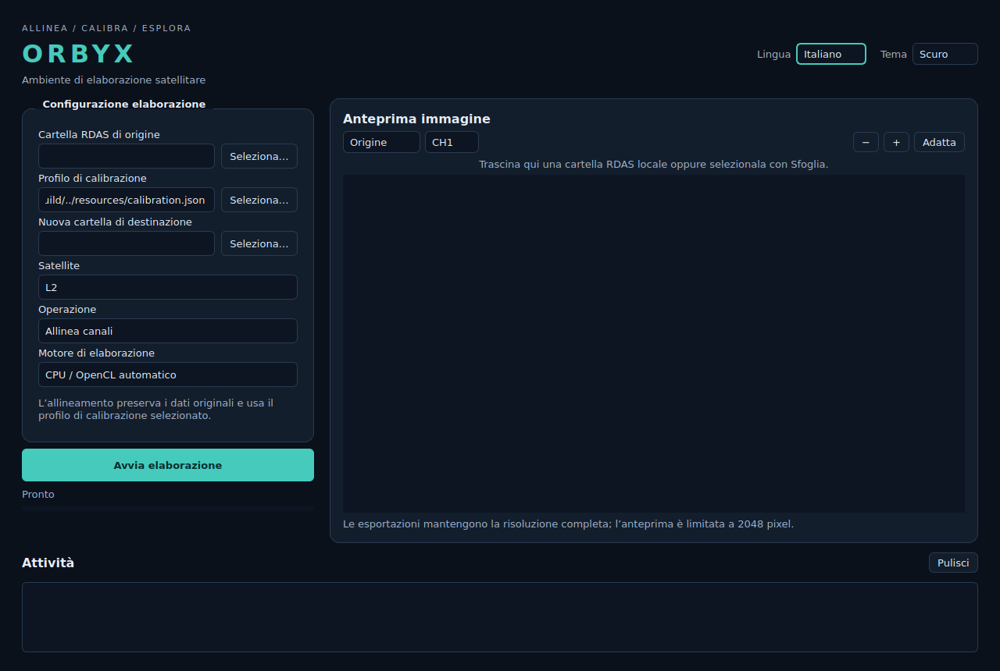

<p align="center"></p>

<p align="center"><a href="README.md">🇬🇧 English</a> · <a href="README.it.md">🇮🇹 Italiano</a></p>

<p align="center">
<a href="https://github.com/chiaraberti13/ORBYX/actions/workflows/ci.yml"></a>


</p>

> Align channels. Reveal the Earth. An independent desktop and headless workflow for RDAS satellite channel alignment.

<p align="center"><a href="ROADMAP.md">Roadmap</a> · <a href="PROGRESS.md">Verification status</a> · <a href="docs/AUDIT.en.md">Audit</a> · <a href="SECURITY.md">Security</a> · <a href="THIRD_PARTY_NOTICES.md">Attributions</a></p>

## Overview

ORBYX modernizes [RDAS Layer Aligner](https://github.com/Digitelektro/rdas_layer_aligner) while retaining its OpenCV affine/ECC approach and calibration coefficients. It operates on SatDump live-decoded `MSUGS_VIS1` and `MSUGS_VIS2` products. It is not a satellite receiver or raw downlink decoder.

This is an initial implementation, not a finished release. Synthetic regressions and [real Elektro-L4/SatDump execution checks](docs/REAL_RDAS.md) are available. Ground-truth geometry, GPU equivalence and the remaining platform checks remain release gates. See [progress](PROGRESS.md) for actual test results.



## Implemented capabilities

- Independent C++17 core and headless CLI, with optional Qt 6 Widgets desktop.
- Affine calibration with ECC (500 iterations, epsilon 1e-7), preserving channel offsets 3606/1804.
- 8/16-bit grayscale PNG alignment, ROI-based left/right merge or separate aligned products.
- Correct separate VIS2 CBOR provenance and deterministic zero-filled merge padding.
- PNG header/dimension checks, validated matrices and ROI bounds, checked output encoding.
- Separate output published by atomic directory rename; existing destinations are refused. Inputs and source profiles remain unchanged.
- Desktop source/config/output selection, asynchronous processing, input/output preview, zoom/pan, diagnostic log, persistent language and light/dark theme.
- Desktop processing queue delegating to the verified batch runner for durable, resumable, no-overwrite sequential execution, and calibration profile duplication (new satellite id from an existing one).
- RGB composition of aligned channels (CH1/CH2/CH3 → R/G/B) preserving 8/16-bit depth with no implicit conversion or loss — generic RGB composition; [Natural Color RGB321](docs/NATURAL_COLOR.md) is also available from CLI and desktop, retaining 8/16-bit depth and tested on genuine Elektro-L4 scenes.
- English/Italian UI, CLI help and application diagnostics; third-party technical error details may remain in their original language.

L2, L3, **L5**, M1 and M2 coefficients are retained. L4 has no bundled coefficients and requires calibration. Automatic satellite identification, folder monitoring, guided ROI editing and application updating are planned, not implemented. The desktop queue and profile duplication are verified at the execution and core level; full interactive and screen-reader verification of the new widgets is still pending. The old upstream `-n/--nc` flag remains unsupported; use `natural-color --ch1 … --ch2 … --ch3 … --output NEW.png` or the desktop export button.

## Build and install

Ubuntu build dependencies:

```bash
sudo apt-get update
sudo apt-get install -y build-essential cmake ninja-build libopencv-dev libjsoncpp-dev qt6-base-dev qt6-qpa-plugins libgl-dev
git clone https://github.com/chiaraberti13/ORBYX.git
cd ORBYX
cmake -S . -B build -G Ninja -DCMAKE_BUILD_TYPE=Release
cmake --build build --parallel 2
ctest --test-dir build --output-on-failure
./build/orbyx-gui
```

For a headless build, add `-DORBYX_BUILD_GUI=OFF`. Qt is then not required. No direct OpenCL SDK is required; OpenCV selects an available backend and otherwise uses CPU. `--cpu` forces the reference CPU path.

Optional installation: `sudo cmake --install build --prefix /usr/local`. Installed calibration data is at `/usr/local/share/orbyx/calibration.json`; pass it explicitly to the CLI. Desktop preferences use the current user's Qt settings. No network access or administrator rights are needed to process images.

## CLI

```bash
./build/orbyx --help
./build/orbyx --lang it --help
./build/orbyx --version
./build/orbyx generate -s L3 -d /data/rdas \
  --config resources/calibration.json --output /data/aligned-new --cpu
./build/orbyx calibrate -s L4 -d /data/rdas \
  --config resources/calibration.json --output /data/calibration-new --cpu
```

The output directory must not exist and its parent must exist. Calibration writes a **new** `calibration.json` inside the output directory, preserving other satellite entries; merge ROIs still need manual validation. To use it, pass that new file with `--config`. Do not assume existing ROIs are valid for a new acquisition.

Input requires two VIS directories containing `MSUGS-VIS-1.png`, `MSUGS-VIS-2.png`, `MSUGS-VIS-3.png`. Generation also requires each relevant `product.cbor`. Channels must be unsigned grayscale 8/16-bit with equal dimensions within each VIS product and height greater than 3606. PNG preflight allows at most 150 million pixels per channel and 1 GiB encoded file; this is not a total memory budget. Large products may require several GiB RAM. Calibration supports an explicit `--calibration-scale` in `(0,1]` (default1); native generation keeps original depth/resolution. See [real-data limits and reproduction](docs/REAL_RDAS.md).

Success returns `0`; validation or processing failure returns `2`. Original short flags `-s`, `-d`, `-m` remain available. `--output` is deliberately required to prevent accidental overwrite. The CLI defaults to `config.json` when `--config` is omitted.

CBOR is copied unchanged, not recalibrated. File-copy tests do not prove SatDump geometry interoperability.

## Batch workflows

An optional Python 3.10+ runner executes sequential jobs with durable state, per-job calibration profiles and content-verified resume. See [batch usage and failure semantics](docs/BATCH.md). It is separate from the desktop queue.

## Architecture and development

- `include/orbyx`, `src/core`: image workflow, profiles and guarded filesystem publication.
- `src/cli`: headless argument parsing.
- `src/gui`: optional Qt interface and worker orchestration.
- `resources`: original calibration coefficients and desktop entry.
- `tests`: deterministic synthetic image and malformed-input regressions.
- `third_party/rdas_layer_aligner`: pinned, unmodified reference snapshot, excluded from the normal build.
- `docs`: [language decision](docs/ADR-001-language.en.md), audit, verification and design records.

Build sanitizers with `-DORBYX_SANITIZE=ON -DORBYX_BUILD_GUI=OFF -DCMAKE_BUILD_TYPE=Debug`. Run `ctest --test-dir build --output-on-failure`. CI covers Ubuntu 22.04/24.04/26.04, sanitizers and static analysis; configured jobs are not proof that the matrix has passed. Distribution packages can be generated experimentally with CPack; they are not a verified release. Native Ubuntu ARM64, clean Fedora44 userspace/RPM and clean Ubuntu22.04 userspace/AppImage checks passed on commit0d7bf19. Interactive desktop sessions/FUSE, Arch/Mint and macOS remain unverified; see [platform evidence](docs/PLATFORMS_REAL.md).

## Security and licence

Use ordinary privileges and trusted parent directories. Native decoders and GPU drivers remain trust boundaries; keep system dependencies updated. See [security policy](SECURITY.md), [contribution guide](CONTRIBUTING.md) and [conduct](CODE_OF_CONDUCT.md).

GNU GPL version 3, with upstream attribution and dependency notices retained. [LICENSE](LICENSE), [NOTICE](NOTICE), [third-party inventory](THIRD_PARTY_NOTICES.md). No upstream affiliation is implied. The original example photographs are not redistributed.

[Verification record / Registro verifiche](docs/VERIFICATION.md) · [Memory limits / Limiti memoria](docs/RESOURCE_LIMITS.md)

[Packaging / Distribuzione](docs/PACKAGING.md)

## Verified Ubuntu builds

The following x86_64 CI builds passed on revision `4190002`: native compilation, seven CTest groups, Debian packaging, installation on the runner and installed CLI/GUI/batch smoke. Desktop tests are offscreen and use synthetic images. [Run evidence](https://github.com/chiaraberti13/ORBYX/actions/runs/42477106167).

| Ubuntu | Build / test | DEB / install smoke |
|---|---|---|
| 22.04 LTS | ✓ | ✓ |
| 24.04 LTS | ✓ | ✓ |
| 26.04 LTS | ✓ | ✓ |

[Observed status of the five real-validation gaps](docs/VERIFICATION_STATUS.md). Fedora44 clean KVM installation and Natural Color on genuine Elektro-L4 data have passed; actual GPU and absolute geometry remain unverified.
